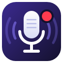

<p align="center"></p>

# Podcast Recorder

Windows için podcast kayıt uygulaması; Linux ve macOS için de [Avalonia sürümü](#linux-ve-macos-avalonia-sürümü) var. Mikrofonu, çalma listesindeki şarkıları ve jingle panelini uygulamanın kendi mikserinde birleştirir ve tek bir MP3, M4A (AAC), WMA, FLAC veya WAV dosyasına kaydeder; isterseniz aynı anda Icecast sunucusuna canlı yayın yapar. Windows "Stereo Mix" ayarı gerekmez.

*A podcast recorder for Windows: mixes microphones, a playlist and jingle pads, records MP3/M4A/WMA/FLAC/WAV with chapter markers and can stream live to Icecast. The interface is available in Turkish and English (status bar › Language).*

## Özellikler

- Birden fazla mikrofon: "Mikrofon ekle" ile her konuk için ayrı kanal, ✕ ile kaldırma; dinleme (kulaklık) cihazı seçimi (WASAPI)
- Kaydet / duraklat / durdur, süre sayacı; MP3 128/192/320 kbps, M4A (AAC) 128/192 kbps, WMA 128/192 kbps, WAV veya FLAC (kayıpsız)
- Kayıt sırasında **Ctrl+B** (ya da "Bölüm" düğmesi) ile bölüm işareti; bkz. [Bölümler](#bölümler)
- **Ayrı izler (multitrack):** Karışıma ek olarak her kanal (her mikrofon, müzik, jingle) `podcast-TARİH izler` klasörüne ayrı dosya olarak kaydedilir; kurguda konuşmacıları ayrı ayrı düzeltmek için
- Mikser: Mikrofon, Müzik, Jingle kanalları; seviye, sessiz, "kulaklıkta duy", VU metre ve clip uyarısı; Master (kayıt) ve Kulaklık seviyesi
- Jingle paneli: sürükle-bırak ya da sağ tık ile dosya ata, tıkla ya da tuşuna basarak çal/durdur
- Çalma listesi: ekle, sırala, çal, sonraki, bitince otomatik sonrakine geç
- Klasör gezgini: dosyaları listeye ya da jingle hücresine sürükle
- Ayarlar `%APPDATA%\PodcastRecorder\settings.json` dosyasında saklanır; yayın şifresi Windows kullanıcısına özel olarak şifrelenir (DPAPI)
- **Mikrofon AÇIK/KAPALI düğmesi:** Kapalıyken mikrofon kayda girmez; açıkken ducking etkinse müzik ayarlanan seviyeye (-3 ile -30 dB arası) yumuşakça kısılır. Jingle'lar kısılmaz.
- **Ducking modu:** "Mikrofon açıkken" (düğme açık olduğu sürece) ya da "Konuşunca (otomatik)": müzik yalnızca mikrofona konuşulurken kısılır, susunca geri gelir. Konuşma eşiği ayarlanabilir.
- **Limiter:** Kayıt -1 dBFS'yi geçmesin diye tepe seviyeleri anlık kısar; kırpılma (clip) olmaz.
- **Gürültü azaltma (RNNoise):** Mikrofonlardaki uğultu, fan ve klavye sesini canlı olarak temizler; kayıt sırasında da açılıp kapatılabilir (açıkken mikrofon 20–30 ms gecikir). Düzenle sekmesindeki "Gürültüyü azalt" kutusu aynı temizliği bitmiş bir kayda uygular; kesim seçmeden de yalnızca temizlenmiş bir kopya yazılabilir. Windows, Linux ve macOS'ta çalışır; RNNoise kütüphanesi bulunamaz ya da çalışmazsa kutular gri olur, uygulama normal çalışmaya devam eder.
- **LUFS ölçer:** Kayıt çubuğunda anlık ve kaydın tamamı için ses yüksekliği (EBU R128 / ITU-R BS.1770-4). Podcast'ler için yaygın hedef -16 LUFS.
- **Normalizasyon:** İşaretlenirse kayıt bitince ses yüksekliği ölçülür ve dosya -16 LUFS'e getirilir (kayıt sırasında geçici bir kayıpsız WAV tutulur, sonra seçilen formatta yazılır).
- **Crossfade:** Çalma listesinde şarkılar 0-10 saniye bindirilerek geçer; otomatik sonrakine geçişte de, elle "Sonraki" ya da başka şarkı çalındığında da uygulanır.
- **Jingle sekmeleri:** Her program için ayrı sekme; sekme adı ve ızgara boyutu (2x2 ile 8x8 arası) değiştirilebilir.
- Canlı yayın: kayda giden ses (Master) bir Icecast sunucusuna MP3 olarak gönderilir; kayıttan bağımsız açılıp kapanır. Bağlantı koparsa 3 saniye arayla 10 kez yeniden bağlanmayı dener.
- Klavye kısayolları (uygulamada F1 ile listelenir)
- **Koyu tema:** Durum çubuğundaki "Tema" kutusundan Sistem (Windows'a göre), Açık ya da Koyu; denetimler WPF Fluent temasıyla çizilir
- **Dil / Language:** Türkçe ya da English; durum çubuğundaki "Dil" kutusundan değişir ve hemen uygulanır (kayıt ve yayın kesilmez). "Sistem" Windows'un görüntü diline göre seçer.
- **Dosya bilgileri:** Başlık, sunucu, program, bölüm no, yıl, tür, açıklama ve kapak resmi her kayda (ve ayrı izlere) yazılır
- **Yapay zeka:** kayıtlardan transkript ve altyazı (yerel Whisper, OpenAI, Azure OpenAI / Foundry, Azure AI Speech), metinden anons ve jingle sesi (Windows sesleri, OpenAI, Azure)
- **Düzenle:** kayıttaki uzun sessizlikleri kısaltır, "ııı", "eee", "hmm" gibi dolgu seslerini bulur; her kesimi dinleyip seçtikten sonra orijinalin yanına `_duzenlenmis` ekli yeni bir dosya yazar (ayrı izler de aynı yerlerden kesilir)

Mikrofon varsayılan olarak kulaklığa verilmez (konuşurken kendi sesinizi gecikmeli duymamanız için) ama her zaman kayda girer.

### Yapay zeka: yazıya çevirme ve seslendirme

"Yapay zeka" bölümü iki iş yapar:

- **Transkript:** Bir kaydı (ya da seçtiğiniz herhangi bir ses dosyasını) yazıya çevirir ve dosyanın yanına aynı adla `.txt` (zaman damgalı metin) ve `.srt` (altyazı) yazar. "Kayıt bitince otomatik çıkar" işaretliyse her kayıttan sonra kendiliğinden başlar. Uzun kayıtlar 10 dakikalık parçalar hâlinde, sessiz yerlerden bölünerek gönderilir.
- **Metinden ses:** Yazdığınız anons ya da jingle metnini seslendirir; dosya kayıt klasöründeki `Anonslar` klasörüne yazılır. Tek tıkla çalma listesine eklenir ya da açık sekmedeki ilk boş jingle hücresine atanır.

| Servis | Yazıya çevirme | Seslendirme | Gereken |
| --- | --- | --- | --- |
| Whisper (bu bilgisayarda) | ✓ | – | Hiçbir şey; model ilk kullanımda Hugging Face'ten indirilir (Tiny 75 MB … Large v3 Turbo 1,6 GB) |
| Windows sesleri | – | ✓ | Türkçe için Windows'ta Türkçe konuşma paketi |
| OpenAI | whisper-1, gpt-4o-transcribe, gpt-4o-mini-transcribe | gpt-4o-mini-tts, tts-1, tts-1-hd | API anahtarı |
| Azure OpenAI / Foundry | Aynı modellerin dağıtımları | Aynı modellerin dağıtımları | Uç nokta, API anahtarı, dağıtım adları |
| Azure AI Speech (Foundry) | Fast transcription | Neural sesler (ör. tr-TR-EmelNeural) | Bölge ve anahtar |

Anahtarlar ayar dosyasında Windows kullanıcınıza özel olarak şifrelenir. Yeni bir servis eklemek için `PodcastRecorder.Speech` projesinde `ISpeechToText` ya da `ITextToSpeech` arayüzünü uygulayıp `SpeechProviders` listesine ekleyin.

### Otomatik kurgu: tek tuşla yayına hazır dosya

**Düzenle** sekmesindeki **Otomatik kurgula** düğmesi seçili kaydı (varsayılan olarak son kaydı) hiçbir onay sormadan yayına hazır hâle getirir ve orijinalin yanına `_yayin` ekli yeni bir dosya yazar; orijinal değişmez. Sırasıyla:

1. Uzun sessizlikleri, dolgu seslerini ve tekrarları bulur (aşağıdaki ayarlarla) ve hepsini keser.
2. "Gürültüyü azalt" işaretliyse kaydı RNNoise ile temizler. Kayıtta müzik ya da jingle varsa kapalı bırakın; RNNoise müziği de bastırır.
3. "Sesi dengele" işaretliyse kayıt boyunca seviyeyi eşitler: kısık kalan yerleri yükseltir, yüksek yerleri kısar (en çok 12 dB, birkaç saniyelik yavaş geçişlerle; duraklamalardaki dip gürültüsü yükseltilmez). Sonra konuşmanın yüksekliğini ölçer, -16 LUFS'a getirir; limiter tepeleri -1 dB'de tutar.
4. Seçildiyse **intro** ve **outro** müziğini ekler: intro tek başına çalar, sonu ilk sözlerin altında kısılarak biter; outro son sözlerin altında kısık başlar, konuşma bitince yükselir. Müzik konuşmadan 3 dB aşağıda, konuşmanın altındayken 14 dB daha kısık çalar; bindirme en çok 4 saniyedir.
5. Dosya bilgilerini ve bölümleri taşır; bölümler kesilen süre kadar öne, intro kadar ileri kayar.

**Tekrarları bul** işaretliyse Whisper dökümünden arka arkaya iki kez söylenen ifadeler ("bugün sizinle, bugün sizinle konuşacağız"), duraksayıp yeniden söylenen kelimeler ("ben, eee, ben") ve yarıda kesilip baştan başlanan kelimeler bulunur; ilk deneme kesilir. Duraksamadan söylenen ikilemelere ("yavaş yavaş") dokunulmaz. Whisper tekrarları çoğu zaman kendisi düzelterek yazdığı için hepsi yakalanmaz. Otomatik kurgudan sonra kesimler listede kalır; beğenmediğinizin işaretini kaldırıp "Dışa aktar" ile elle de yazabilirsiniz.

### Düzenle: sessizlik ve dolgu seslerini kesme

Orta bölümdeki **Düzenle** sekmesi bir kaydı (varsayılan olarak son kaydı) tarar ve kesilebilecek yerleri listeler. Sekme açıkken alttaki mikser satırı listeye yer açmak için gizlenir.

- **Sessizlikler:** Ses 20 ms'lik pencerelerde ölçülür (RMS, dBFS). "Sessizlik eşiği"nin (varsayılan -40 dB) altında kalan ve "En kısa sessizlik"ten (0,8 sn) uzun her duraklama tamamen silinmez, "Bırakılan boşluk" (0,3 sn; yarısı başta, yarısı sonda) kadarı kalır.
- **Dolgu sesleri:** "Dolgu seslerini bul" işaretliyse kayıt bu bilgisayardaki Whisper ile kelime kelime (token zaman damgalarıyla) yazıya çevrilir ve listedeki sesler kesim olur. Whisper normalde "eee"leri yazmaz; bu yüzden modele dolgu sesleriyle dolu bir başlangıç metni verilir. Liste virgülle ayrılır, harf tekrarı önemsizdir ("eee" yazmak "ee" ve "eeeee"yi de bulur); "şey", "yani" gibi kelimeler eklenebilir. Model Yapay zeka › Servis ayarları › Whisper'dan seçilir, ilk kullanımda indirilir.
- **Liste:** Her kesimin zamanı, süresi, türü, duyulan metin ve Whisper'ın güveni görünür. **Orijinal** kesimin çevresindeki birkaç saniyeyi olduğu gibi, **Kesilmiş** aynı yeri kesilmiş hâliyle çalar; önizleme yalnızca kulaklık çıkışından duyulur, kayda ve yayına girmez. "Tümü / Hiçbiri" ile türe göre seçilir; altta toplam kazanılan süre yazar.
- **Dışa aktar:** Seçili kesimler atlanarak yeni dosya yazılır (varsayılan FLAC, WAV kayıtlarda WAV; diğer biçimler de seçilebilir). Her kesim noktasında tıkırtı olmasın diye 15 ms'lik eşit güçlü (equal-power) crossfade yapılır; dosya tam olarak "orijinal süre - kesimler" uzunluğundadır. Orijinal dosyaya dokunulmaz, dosya bilgileri (başlık, kapak…) kopyalanır. Bölümler de kopyalanır, kesilen süre kadar öne kaydırılarak. Çok izli kayıtlarda `izler` klasöründeki her iz aynı kesim listesiyle yazılır, böylece izler senkron kalır.

Sınırlamalar: Whisper'ın kelime zamanları yaklaşıktır (onlarca milisaniye), bu yüzden dolgu kesimleri komşu kelimelere değmeyecek kadar küçük bir payla (40 ms) genişletilir. Whisper her dolgu sesini yakalamaz; özellikle kısa "e"ler ve kelimeye yapışık uzatmalar kaçabilir, modelden modele de sonuç değişir. Bulunanları önizleyip gerekirse işaretini kaldırın. Uzun kayıtlarda dolgu taraması işlemcide birkaç dakika sürebilir (Base modeliyle 3 dakikalık kayıt yaklaşık 15 saniye); sessizlik taraması saniyeler içinde biter. Kesim motoru arayüzden bağımsızdır (`PodcastRecorder.Audio/Editing`, dolgu tarafı `PodcastRecorder.Speech/Fillers`), ileride komut satırı aracı olarak da kullanılabilir.

### Dosya bilgileri

Alttaki durum çubuğunda **Dosya bilgileri…** düğmesi açar. Başlık (boşsa dosya adı), Sunucu / Sanatçı, Program / Albüm, Bölüm no, Yıl, Tür (varsayılan "Podcast"), Açıklama ve Kapak resmi (JPEG ya da PNG) kayıt bitince dosyaya yazılır; WMA çevirme ve normalizasyondan sonra, son dosyaya. Ayrı izler aynı bilgileri alır, başlığın sonuna iz adı eklenir (ör. "Bölüm 12 - Mikrofon 1"). Bölüm no her kayıttan sonra bir artar; sunucu, program, tür, kapak ve sıradaki bölüm no ayarlarda saklanır.

- **Son kayda yaz:** Bir yazım hatasını düzeltip bilgileri son kayda yeniden yazar; o kaydın bölüm numarası korunur.
- **Dosyaya yaz…:** Seçilen herhangi bir ses dosyasına yazar.

Biçimler: MP3'te ID3v2.3 (Windows Gezgini ve çoğu çalar bunu okur), FLAC'ta Vorbis yorumları, WMA'da ASF, WAV'da RIFF INFO ve ID3v2.3. Yazma işi [TagLib#](https://github.com/mono/taglib-sharp) ile yapılır (`Recording/RecordingTags.cs`).

### Klavye kısayolları

| Tuş | İşlem |
| --- | --- |
| Ctrl+R | Kaydı başlat |
| Ctrl+P | Duraklat / devam |
| Ctrl+Shift+R | Kaydı durdur ve kaydet |
| Ctrl+M | Mikrofonu kapat / aç |
| Ctrl+B | Bölüm işareti koy |
| Ctrl+L / Ctrl+Shift+L | Yayına başla / yayını durdur |
| F5 / F6 / F7 | Çalma listesi: çal / durdur / sonraki |
| 1–8, Q–I, A–K, Z–M | Açık sekmedeki jingle hücreleri, paneldeki yerleriyle aynı (4x4 sekmede 1234 / QWER / ASDF / ZXCV); tuş her hücrenin köşesinde yazar |
| Esc | Bütün jingle'ları durdur |
| F1 | Kısayol listesi |

Durdurma tuşları kazara basılmasın diye Shift ister.

### Canlı yayın

"Canlı yayın" panelindeki **Ayarlar…** ile sunucu, port, mount (ör. `/canli`), kullanıcı (Icecast'te genelde `source`), şifre ve kaliteyi girin. Yayın Icecast 2.4+ kaynak protokolüyle (HTTP PUT) gönderilir; çalma listesinde şarkı değişince dinleyicilerin gördüğü başlık güncellenir. Bağlantı yavaşlarsa ses kuyrukta birikmez, bir kısmı atlanır ve panelde uyarı görünür; bağlantı koparsa 3 saniye arayla 10 kez yeniden bağlanmayı dener.

### Bölümler

Kayıt sürerken **Ctrl+B** ya da kayıt çubuğundaki **Bölüm** düğmesi o ana bir işaret koyar (duraklatılmış süre sayılmaz, işaret dosyadaki yere denk gelir). Kayıt bitince işaretler bölüm olarak dosyaya yazılır: ilk bölüm kaydın başından ilk işarete kadardır, sonra her işaret yeni bir bölüm başlatır ("Bölüm 1", "Bölüm 2"…). Bir saniyeden yakın iki işaretten ikincisi atlanır. Bölümler dosya bilgilerinden sonra, normalizasyon ve çevirmeden sonraki son dosyaya ve ayrı izlere yazılır; Düzenle sekmesinde dışa aktarırken kesilen süre kadar öne kaydırılır.

- **MP3:** ID3v2 CHAP çerçeveleri ve onları sıralayan üst düzey CTOC (Apple Podcasts, Overcast, Pocket Casts, foobar2000…).
- **M4A:** ffmpeg'in yazdığı gibi iki biçim birden: ses izinin `chap` ile gösterdiği QuickTime metin izi (Apple Podcasts, iTunes, QuickTime) ve Nero `chpl` listesi (VLC, mpv, birçok Android çalar). Ses verisine dokunulmaz.
- **FLAC:** `CHAPTER001=00:00:00.000` / `CHAPTER001NAME=…` Vorbis yorumları.
- WAV ve WMA bölüm tutmaz; bu biçimlerde durum çubuğu bunu söyler.

Kod: `Recording/Chapters.cs`, `Recording/Mp4Chapters.cs`.

### M4A (AAC)

Windows'ta Media Foundation AAC kodlayıcısıyla, Linux ve macOS'ta ffmpeg ile yazılır. WMA gibi kayıt önce geçici bir WAV (`.m4a.kayit.wav`) olarak yazılır ve durdurulunca çevrilir; çevirme başarısız olursa kayıt `.wav` olarak saklanır.

### WMA

WMA, Windows Media Foundation kodlayıcısıyla yazılır. Media Foundation dosyayı bütün olarak kodladığından kayıt önce yanına geçici bir WAV (`.wma.kayit.wav`) olarak yazılır ve durdurulunca WMA'ya çevrilir; çevirme başarısız olursa kayıt `.wav` olarak saklanır. Windows Server'da "Media Foundation" özelliği gerekebilir.

## Linux ve macOS (Avalonia sürümü)

`src/PodcastRecorder.Avalonia` aynı uygulamanın Avalonia ile yazılmış, Windows, Linux ve macOS'ta çalışan sürümüdür. ViewModel'ler ve ayarlar WPF uygulamasıyla ortaktır (aynı dosyalar derlenir), yalnızca arayüz ve birkaç platform servisi ayrıdır. Ses Windows'ta yine WASAPI ile, Linux ve macOS'ta PortAudio ile (ALSA, PulseAudio/PipeWire, Core Audio) çalınır ve kaydedilir.

```bash
dotnet run --project src/PodcastRecorder.Avalonia
```

Windows sürümünden farkları:

| Özellik | Linux / macOS |
| --- | --- |
| WMA kaydı | Yok (Media Foundation yalnızca Windows'ta). MP3, M4A (ffmpeg ile), FLAC ve WAV var. |
| MP3 kaydı ve canlı yayın | Sistemdeki LAME kütüphanesi gerekir: `sudo apt install libmp3lame0` ya da `brew install lame` |
| Çalma | MP3 ve WAV doğrudan; FLAC, M4A, AAC ve WMA için `ffmpeg` gerekir (`sudo apt install ffmpeg`, `brew install ffmpeg`) |
| Seslendirme (bu bilgisayarda) | Windows sesleri yerine Linux'ta espeak-ng (`sudo apt install espeak-ng`, Türkçe için ses adı `tr`), macOS'ta `say` (Türkçe ses "Yelda") |
| API anahtarları | DPAPI yerine ayar klasöründeki, yalnızca kullanıcının okuyabildiği bir anahtarla AES-GCM ile şifrelenir |
| Çıkış cihazı | 48 kHz açılamayan bir donanım cihazında `default`, `pulse` ya da `pipewire` cihazını seçin |

Whisper (yerel), OpenAI, Azure OpenAI / Foundry ve Azure AI Speech her platformda aynı çalışır. Ayarlar Linux'ta `~/.config/PodcastRecorder`, macOS'ta `~/Library/Application Support/PodcastRecorder` altındadır.

### Linux'ta kurulum

Release'teki `PodcastRecorder-<sürüm>-x86_64.AppImage` dosyasını indirip çalıştırılabilir yapın (`chmod +x PodcastRecorder-*.AppImage` ya da dosya yöneticisinde Özellikler › İzinler) ve çift tıklayın. Ubuntu 22.04 ve sonrasında AppImage'ların çalışması için bir kez `sudo apt install libfuse2t64` (22.04'te `libfuse2`) gerekebilir. MP3 için LAME ve FLAC/M4A için ffmpeg yine sistemden kullanılır. Aynı derleme klasör olarak `PodcastRecorder-<sürüm>-linux-x64.tar.gz` içinde de vardır.

### macOS'ta kurulum

Release sayfasındaki `PodcastRecorder-<sürüm>-osx-arm64.zip` (Apple Silicon) ya da `-osx-x64.zip` (Intel) içinde çift tıklayarak açılan `Podcast Recorder.app` vardır; .NET kurmak gerekmez.

1. Zip'i açın ve `Podcast Recorder.app` dosyasını Uygulamalar klasörüne sürükleyin.
2. Uygulama Apple Developer hesabıyla imzalanmadığı (noter onayı olmadığı) için macOS ilk açılışta engeller. Bir kez izin verin: Sistem Ayarları › Gizlilik ve Güvenlik › "Yine de Aç". Ya da Terminal'de:

   ```bash
   xattr -dr com.apple.quarantine "/Applications/Podcast Recorder.app"
   ```

3. İlk kayıtta macOS mikrofon izni ister; sonradan Sistem Ayarları › Gizlilik ve Güvenlik › Mikrofon altından değiştirilebilir.

MP3 ve ffmpeg için yukarıdaki `brew install lame ffmpeg` yeterlidir; uygulama Finder'dan açıldığında da Homebrew klasörlerini bulur.

## Gereksinimler

- Windows 10/11
- [.NET 11 SDK](https://dotnet.microsoft.com/download/dotnet/11.0)

## Çalıştırma

```powershell
dotnet run --project src/PodcastRecorder.App
```

Testler:

```powershell
dotnet test
```

## Sürüm çıkarmak

Sürüm numarası `Directory.Build.props` içindeki `<Version>` alanındadır. `v` ile başlayan bir tag push edildiğinde GitHub Actions testleri çalıştırır, uygulamayı .NET kurulumu gerektirmeyen (self-contained) win-x64 olarak yayınlar ve zip'i GitHub Releases'a ekler. Avalonia sürümü de linux-x64 için `.tar.gz` ve tek dosyalık `PodcastRecorder-<sürüm>-x86_64.AppImage` (`src/PodcastRecorder.Avalonia/linux/package-appimage.sh`), osx-arm64 (Apple Silicon) ve osx-x64 (Intel) için zip'lenmiş `Podcast Recorder.app` olarak eklenir (`src/PodcastRecorder.Avalonia/macOS/package-app.sh`):

```powershell
git tag v0.0.1
git push origin v0.0.1
```

## Proje yapısı

| Proje | İçerik |
| --- | --- |
| `src/PodcastRecorder.Audio` | Ses motoru: mikser, kaynaklar (mikrofon, çalma listesi, jingle), kayıt ve encoder'lar. NAudio üzerine kurulu. |
| `src/PodcastRecorder.Speech` | Yazıya çevirme ve seslendirme servisleri (Whisper.net, OpenAI / Azure REST, Windows sesleri, espeak-ng / say) |
| `src/PodcastRecorder.Audio.PortAudio` | Linux ve macOS ses cihazları (PortAudio); Windows'ta `WasapiBackend` kullanılır |
| `src/PodcastRecorder.App` | WPF arayüzü (MVVM, CommunityToolkit.Mvvm); ViewModel'ler Avalonia sürümüyle ortak |
| `src/PodcastRecorder.Avalonia` | Windows, Linux ve macOS için Avalonia arayüzü |
| `tests/PodcastRecorder.Audio.Tests` | Ses motoru birim testleri (xUnit) |

### Ses akışı

```
Mikrofon ─┐                    ┌─> Program bus ─> Recorder ─> IAudioEncoder (MP3/WAV) ─> dosya
Müzik ────┼─> AudioMixer ──────┤
Jingle ───┘                    └─> Monitor bus ─> IAudioOutput (kulaklık: WASAPI ya da PortAudio)
```

Tüm kaynaklar 48 kHz stereo float formatına çevrilir. Çıkış cihazının saati akışı sürer; kodlama ayrı bir arka plan görevinde yapılır, böylece disk yazımı sesi takıltmaz.

### Yeni çıktı formatı eklemek

`IAudioEncoder` arayüzünü uygulayın ve `EncoderCatalog.All` listesine ekleyin; arayüzdeki format listesi otomatik güncellenir.

### Metinler ve diller

Kullanıcıya görünen bütün metinler `.resx` dosyalarındadır: `Strings.resx` Türkçe (varsayılan dil), `Strings.en.resx` İngilizce. App'te `src/PodcastRecorder.App/Localization`, kütüphanelerde proje kökünde durur. XAML'da `{loc:T Anahtar}`, C#'ta `Loc.T("Anahtar")` ya da `Loc.F("Anahtar", değer)` kullanılır; kütüphaneler kendi `Texts` sınıfıyla okur. Dil değişince ana pencere aynı view model üzerine yeniden kurulur. Yeni bir metin eklerken iki dosyaya da yazın; `LocalizationTests` anahtarların ve `{0}` yer tutucularının iki dilde aynı olduğunu denetler. Yeni bir dil için `Strings.xx.resx` dosyalarını ekleyip `Loc.Languages` listesine yazmanız yeterli.
