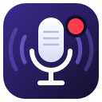

<p align="center"></p>

# Podcast Recorder

Windows için podcast kayıt uygulaması; Linux ve macOS için de [Avalonia sürümü](#linux-ve-macos-avalonia-sürümü) var. Mikrofonu, çalma listesindeki şarkıları ve jingle panelini uygulamanın kendi mikserinde birleştirir ve tek bir MP3, WMA, FLAC veya WAV dosyasına kaydeder; isterseniz aynı anda Icecast sunucusuna canlı yayın yapar. Windows "Stereo Mix" ayarı gerekmez.

*A podcast recorder for Windows: mixes microphones, a playlist and jingle pads, records MP3/WMA/FLAC/WAV and can stream live to Icecast. The interface is available in Turkish and English (status bar › Language).*

## Özellikler

- Birden fazla mikrofon: "Mikrofon ekle" ile her konuk için ayrı kanal, ✕ ile kaldırma; dinleme (kulaklık) cihazı seçimi (WASAPI)
- Kaydet / duraklat / durdur, süre sayacı; MP3 128/192/320 kbps, WMA 128/192 kbps, WAV veya FLAC (kayıpsız)
- **Ayrı izler (multitrack):** Karışıma ek olarak her kanal (her mikrofon, müzik, jingle) `podcast-TARİH izler` klasörüne ayrı dosya olarak kaydedilir; kurguda konuşmacıları ayrı ayrı düzeltmek için
- Mikser: Mikrofon, Müzik, Jingle kanalları; seviye, sessiz, "kulaklıkta duy", VU metre ve clip uyarısı; Master (kayıt) ve Kulaklık seviyesi
- Jingle paneli: sürükle-bırak ya da sağ tık ile dosya ata, tıkla ya da tuşuna basarak çal/durdur
- Çalma listesi: ekle, sırala, çal, sonraki, bitince otomatik sonrakine geç
- Klasör gezgini: dosyaları listeye ya da jingle hücresine sürükle
- Ayarlar `%APPDATA%\PodcastRecorder\settings.json` dosyasında saklanır; yayın şifresi Windows kullanıcısına özel olarak şifrelenir (DPAPI)
- **Mikrofon AÇIK/KAPALI düğmesi:** Kapalıyken mikrofon kayda girmez; açıkken ducking etkinse müzik ayarlanan seviyeye (-3 ile -30 dB arası) yumuşakça kısılır. Jingle'lar kısılmaz.
- **Ducking modu:** "Mikrofon açıkken" (düğme açık olduğu sürece) ya da "Konuşunca (otomatik)": müzik yalnızca mikrofona konuşulurken kısılır, susunca geri gelir. Konuşma eşiği ayarlanabilir.
- **Limiter:** Kayıt -1 dBFS'yi geçmesin diye tepe seviyeleri anlık kısar; kırpılma (clip) olmaz.
- **LUFS ölçer:** Kayıt çubuğunda anlık ve kaydın tamamı için ses yüksekliği (EBU R128 / ITU-R BS.1770-4). Podcast'ler için yaygın hedef -16 LUFS.
- **Normalizasyon:** İşaretlenirse kayıt bitince ses yüksekliği ölçülür ve dosya -16 LUFS'e getirilir (kayıt sırasında geçici bir kayıpsız WAV tutulur, sonra seçilen formatta yazılır).
- **Crossfade:** Çalma listesinde şarkılar 0-10 saniye bindirilerek geçer; otomatik sonrakine geçişte de, elle "Sonraki" ya da başka şarkı çalındığında da uygulanır.
- **Jingle sekmeleri:** Her program için ayrı sekme; sekme adı ve ızgara boyutu (2x2 ile 8x8 arası) değiştirilebilir.
- Canlı yayın: kayda giden ses (Master) bir Icecast sunucusuna MP3 olarak gönderilir; kayıttan bağımsız açılıp kapanır. Bağlantı koparsa 3 saniye arayla 10 kez yeniden bağlanmayı dener.
- Klavye kısayolları (uygulamada F1 ile listelenir)
- **Koyu tema:** Durum çubuğundaki "Tema" kutusundan Sistem (Windows'a göre), Açık ya da Koyu; denetimler WPF Fluent temasıyla çizilir
- **Dil / Language:** Türkçe ya da English; durum çubuğundaki "Dil" kutusundan değişir ve hemen uygulanır (kayıt ve yayın kesilmez). "Sistem" Windows'un görüntü diline göre seçer.
- **Dosya bilgileri:** Başlık, sunucu, program, bölüm no, yıl, tür, açıklama ve kapak resmi her kayda (ve ayrı izlere) yazılır
- **Yapay zeka:** kayıtlardan transkript ve altyazı (yerel Whisper, OpenAI, Azure OpenAI / Foundry, Azure AI Speech), metinden anons ve jingle sesi (Windows sesleri, OpenAI, Azure)

Mikrofon varsayılan olarak kulaklığa verilmez (konuşurken kendi sesinizi gecikmeli duymamanız için) ama her zaman kayda girer.

### Yapay zeka: yazıya çevirme ve seslendirme

"Yapay zeka" bölümü iki iş yapar:

- **Transkript:** Bir kaydı (ya da seçtiğiniz herhangi bir ses dosyasını) yazıya çevirir ve dosyanın yanına aynı adla `.txt` (zaman damgalı metin) ve `.srt` (altyazı) yazar. "Kayıt bitince otomatik çıkar" işaretliyse her kayıttan sonra kendiliğinden başlar. Uzun kayıtlar 10 dakikalık parçalar hâlinde, sessiz yerlerden bölünerek gönderilir.
- **Metinden ses:** Yazdığınız anons ya da jingle metnini seslendirir; dosya kayıt klasöründeki `Anonslar` klasörüne yazılır. Tek tıkla çalma listesine eklenir ya da açık sekmedeki ilk boş jingle hücresine atanır.

| Servis | Yazıya çevirme | Seslendirme | Gereken |
| --- | --- | --- | --- |
| Whisper (bu bilgisayarda) | ✓ | – | Hiçbir şey; model ilk kullanımda Hugging Face'ten indirilir (Tiny 75 MB … Large v3 Turbo 1,6 GB) |
| Windows sesleri | – | ✓ | Türkçe için Windows'ta Türkçe konuşma paketi |
| OpenAI | whisper-1, gpt-4o-transcribe, gpt-4o-mini-transcribe | gpt-4o-mini-tts, tts-1, tts-1-hd | API anahtarı |
| Azure OpenAI / Foundry | Aynı modellerin dağıtımları | Aynı modellerin dağıtımları | Uç nokta, API anahtarı, dağıtım adları |
| Azure AI Speech (Foundry) | Fast transcription | Neural sesler (ör. tr-TR-EmelNeural) | Bölge ve anahtar |

Anahtarlar ayar dosyasında Windows kullanıcınıza özel olarak şifrelenir. Yeni bir servis eklemek için `PodcastRecorder.Speech` projesinde `ISpeechToText` ya da `ITextToSpeech` arayüzünü uygulayıp `SpeechProviders` listesine ekleyin.

### Dosya bilgileri

Alttaki durum çubuğunda **Dosya bilgileri…** düğmesi açar. Başlık (boşsa dosya adı), Sunucu / Sanatçı, Program / Albüm, Bölüm no, Yıl, Tür (varsayılan "Podcast"), Açıklama ve Kapak resmi (JPEG ya da PNG) kayıt bitince dosyaya yazılır; WMA çevirme ve normalizasyondan sonra, son dosyaya. Ayrı izler aynı bilgileri alır, başlığın sonuna iz adı eklenir (ör. "Bölüm 12 - Mikrofon 1"). Bölüm no her kayıttan sonra bir artar; sunucu, program, tür, kapak ve sıradaki bölüm no ayarlarda saklanır.

- **Son kayda yaz:** Bir yazım hatasını düzeltip bilgileri son kayda yeniden yazar; o kaydın bölüm numarası korunur.
- **Dosyaya yaz…:** Seçilen herhangi bir ses dosyasına yazar.

Biçimler: MP3'te ID3v2.3 (Windows Gezgini ve çoğu çalar bunu okur), FLAC'ta Vorbis yorumları, WMA'da ASF, WAV'da RIFF INFO ve ID3v2.3. Yazma işi [TagLib#](https://github.com/mono/taglib-sharp) ile yapılır (`Recording/RecordingTags.cs`).

### Klavye kısayolları

| Tuş | İşlem |
| --- | --- |
| Ctrl+R | Kaydı başlat |
| Ctrl+P | Duraklat / devam |
| Ctrl+Shift+R | Kaydı durdur ve kaydet |
| Ctrl+M | Mikrofonu kapat / aç |
| Ctrl+L / Ctrl+Shift+L | Yayına başla / yayını durdur |
| F5 / F6 / F7 | Çalma listesi: çal / durdur / sonraki |
| 1–8, Q–I, A–K, Z–M | Açık sekmedeki jingle hücreleri, paneldeki yerleriyle aynı (4x4 sekmede 1234 / QWER / ASDF / ZXCV); tuş her hücrenin köşesinde yazar |
| Esc | Bütün jingle'ları durdur |
| F1 | Kısayol listesi |

Durdurma tuşları kazara basılmasın diye Shift ister.

### Canlı yayın

"Canlı yayın" panelindeki **Ayarlar…** ile sunucu, port, mount (ör. `/canli`), kullanıcı (Icecast'te genelde `source`), şifre ve kaliteyi girin. Yayın Icecast 2.4+ kaynak protokolüyle (HTTP PUT) gönderilir; çalma listesinde şarkı değişince dinleyicilerin gördüğü başlık güncellenir. Bağlantı yavaşlarsa ses kuyrukta birikmez, bir kısmı atlanır ve panelde uyarı görünür; bağlantı koparsa 3 saniye arayla 10 kez yeniden bağlanmayı dener.

### WMA

WMA, Windows Media Foundation kodlayıcısıyla yazılır. Media Foundation dosyayı bütün olarak kodladığından kayıt önce yanına geçici bir WAV (`.wma.kayit.wav`) olarak yazılır ve durdurulunca WMA'ya çevrilir; çevirme başarısız olursa kayıt `.wav` olarak saklanır. Windows Server'da "Media Foundation" özelliği gerekebilir.

## Linux ve macOS (Avalonia sürümü)

`src/PodcastRecorder.Avalonia` aynı uygulamanın Avalonia ile yazılmış, Windows, Linux ve macOS'ta çalışan sürümüdür. ViewModel'ler ve ayarlar WPF uygulamasıyla ortaktır (aynı dosyalar derlenir), yalnızca arayüz ve birkaç platform servisi ayrıdır. Ses Windows'ta yine WASAPI ile, Linux ve macOS'ta PortAudio ile (ALSA, PulseAudio/PipeWire, Core Audio) çalınır ve kaydedilir.

```bash
dotnet run --project src/PodcastRecorder.Avalonia
```

Windows sürümünden farkları:

| Özellik | Linux / macOS |
| --- | --- |
| WMA kaydı | Yok (Media Foundation yalnızca Windows'ta). MP3, FLAC ve WAV var. |
| MP3 kaydı ve canlı yayın | Sistemdeki LAME kütüphanesi gerekir: `sudo apt install libmp3lame0` ya da `brew install lame` |
| Çalma | MP3 ve WAV doğrudan; FLAC, M4A, AAC ve WMA için `ffmpeg` gerekir (`sudo apt install ffmpeg`, `brew install ffmpeg`) |
| Seslendirme (bu bilgisayarda) | Windows sesleri yerine Linux'ta espeak-ng (`sudo apt install espeak-ng`, Türkçe için ses adı `tr`), macOS'ta `say` (Türkçe ses "Yelda") |
| API anahtarları | DPAPI yerine ayar klasöründeki, yalnızca kullanıcının okuyabildiği bir anahtarla AES-GCM ile şifrelenir |
| Çıkış cihazı | 48 kHz açılamayan bir donanım cihazında `default`, `pulse` ya da `pipewire` cihazını seçin |

Whisper (yerel), OpenAI, Azure OpenAI / Foundry ve Azure AI Speech her platformda aynı çalışır. Ayarlar Linux'ta `~/.config/PodcastRecorder`, macOS'ta `~/Library/Application Support/PodcastRecorder` altındadır.

## Gereksinimler

- Windows 10/11
- [.NET 10 SDK](https://dotnet.microsoft.com/download/dotnet/10.0)

## Çalıştırma

```powershell
dotnet run --project src/PodcastRecorder.App
```

Testler:

```powershell
dotnet test
```

## Sürüm çıkarmak

Sürüm numarası `Directory.Build.props` içindeki `<Version>` alanındadır. `v` ile başlayan bir tag push edildiğinde GitHub Actions testleri çalıştırır, uygulamayı .NET kurulumu gerektirmeyen (self-contained) win-x64 olarak yayınlar ve zip'i GitHub Releases'a ekler. Avalonia sürümü de linux-x64 ve osx-arm64 için `.tar.gz` olarak eklenir:

```powershell
git tag v0.0.1
git push origin v0.0.1
```

## Proje yapısı

| Proje | İçerik |
| --- | --- |
| `src/PodcastRecorder.Audio` | Ses motoru: mikser, kaynaklar (mikrofon, çalma listesi, jingle), kayıt ve encoder'lar. NAudio üzerine kurulu. |
| `src/PodcastRecorder.Speech` | Yazıya çevirme ve seslendirme servisleri (Whisper.net, OpenAI / Azure REST, Windows sesleri, espeak-ng / say) |
| `src/PodcastRecorder.Audio.PortAudio` | Linux ve macOS ses cihazları (PortAudio); Windows'ta `WasapiBackend` kullanılır |
| `src/PodcastRecorder.App` | WPF arayüzü (MVVM, CommunityToolkit.Mvvm); ViewModel'ler Avalonia sürümüyle ortak |
| `src/PodcastRecorder.Avalonia` | Windows, Linux ve macOS için Avalonia arayüzü |
| `tests/PodcastRecorder.Audio.Tests` | Ses motoru birim testleri (xUnit) |

### Ses akışı

```
Mikrofon ─┐                    ┌─> Program bus ─> Recorder ─> IAudioEncoder (MP3/WAV) ─> dosya
Müzik ────┼─> AudioMixer ──────┤
Jingle ───┘                    └─> Monitor bus ─> IAudioOutput (kulaklık: WASAPI ya da PortAudio)
```

Tüm kaynaklar 48 kHz stereo float formatına çevrilir. Çıkış cihazının saati akışı sürer; kodlama ayrı bir arka plan görevinde yapılır, böylece disk yazımı sesi takıltmaz.

### Yeni çıktı formatı eklemek

`IAudioEncoder` arayüzünü uygulayın ve `EncoderCatalog.All` listesine ekleyin; arayüzdeki format listesi otomatik güncellenir.

### Metinler ve diller

Kullanıcıya görünen bütün metinler `.resx` dosyalarındadır: `Strings.resx` Türkçe (varsayılan dil), `Strings.en.resx` İngilizce. App'te `src/PodcastRecorder.App/Localization`, kütüphanelerde proje kökünde durur. XAML'da `{loc:T Anahtar}`, C#'ta `Loc.T("Anahtar")` ya da `Loc.F("Anahtar", değer)` kullanılır; kütüphaneler kendi `Texts` sınıfıyla okur. Dil değişince ana pencere aynı view model üzerine yeniden kurulur. Yeni bir metin eklerken iki dosyaya da yazın; `LocalizationTests` anahtarların ve `{0}` yer tutucularının iki dilde aynı olduğunu denetler. Yeni bir dil için `Strings.xx.resx` dosyalarını ekleyip `Loc.Languages` listesine yazmanız yeterli.
